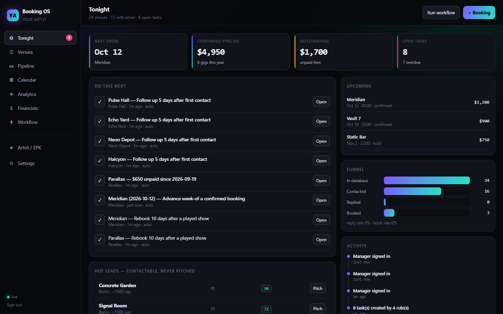
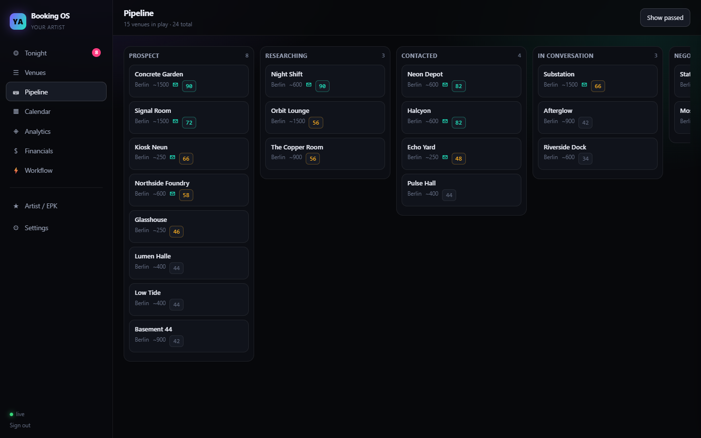
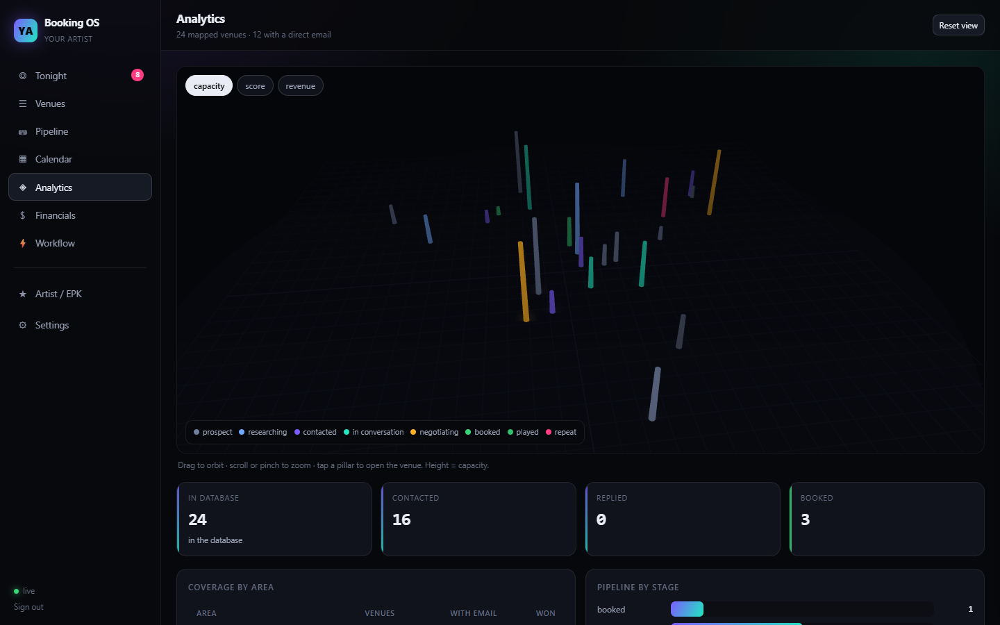
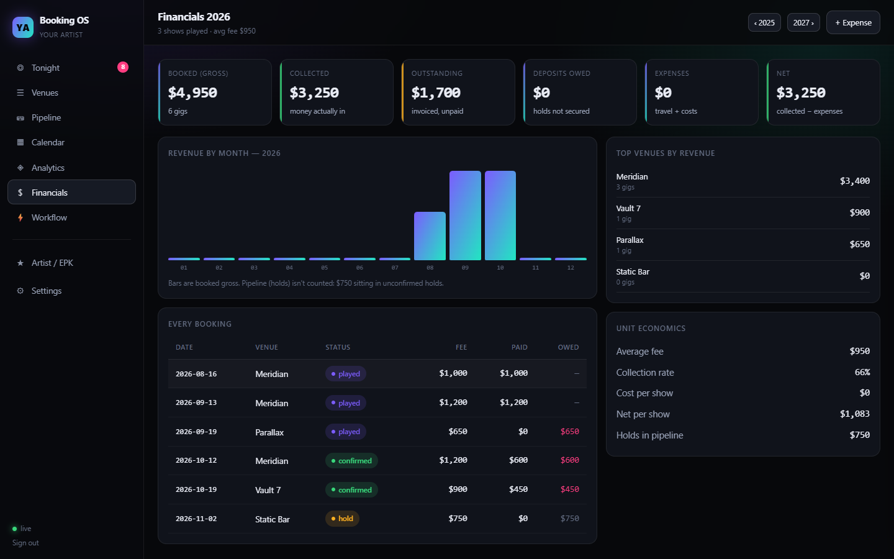
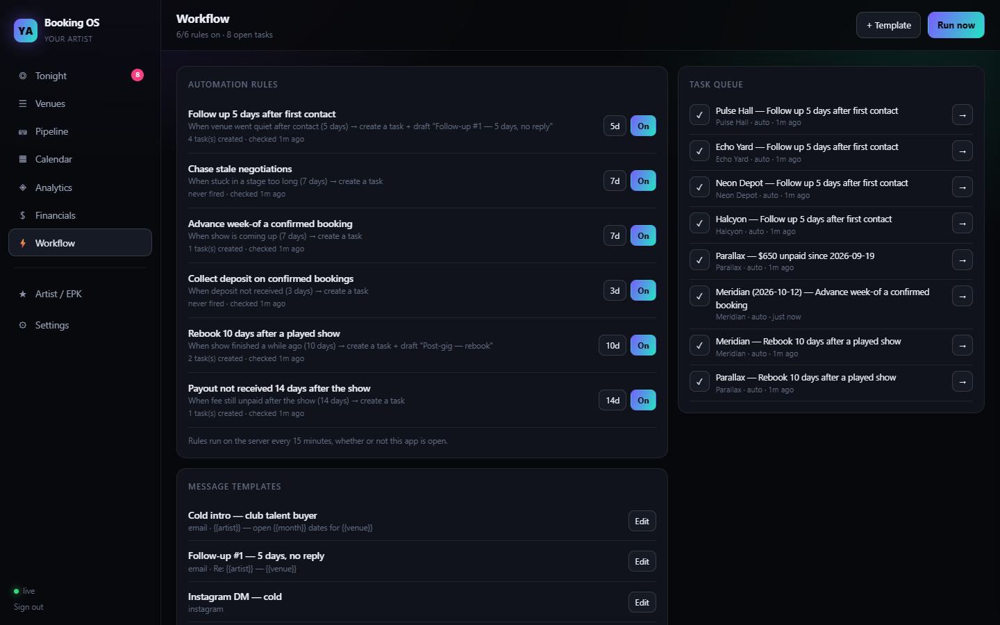
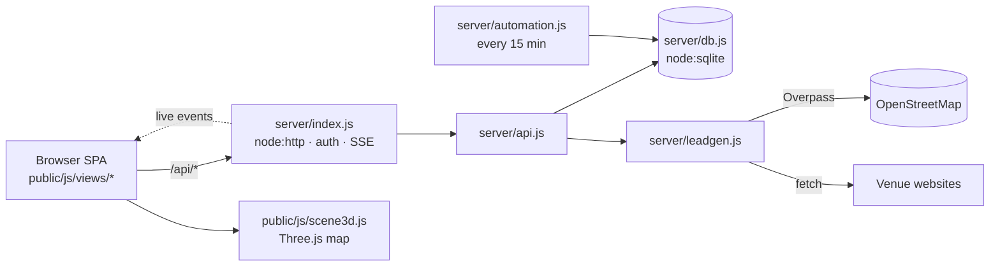

<h1 align="center">booking-os</h1>

<p align="center">A booking CRM and venue lead generator for DJ and artist managers.</p>

<p align="center">
It finds venues, tracks the pipeline, books dates, chases the money and writes the follow-ups. Zero npm dependencies.
</p>



## Who it is for

DJ and artist managers who book live shows across many venues and need one place for prospecting,
negotiation, the calendar, deposits and payouts. It is a single-manager app with one login.

## Features

| View | What it does |
|---|---|
| **Tonight** | Next show, tasks the workflow rules created, hot leads nobody has pitched yet, the funnel and a live activity feed. |
| **Venues** | Every venue with contacts and a lead score. Filter by stage, area or whether it can be contacted. CSV export. |
| **Pipeline** | Nine-stage board from prospect to repeat client. Drag on desktop, long-press on a phone. |
| **Calendar** | Month grid and agenda. Holds, confirmations, played and cancelled shows. |
| **Analytics** | A 3D venue map. Every venue is a pillar at its real position, coloured by stage, with height showing capacity, lead score or revenue. |
| **Financials** | Booked, collected, outstanding, deposits owed, expenses, net, revenue per venue and unit economics. |
| **Workflow** | Six automation rules and message templates with merge fields. The rules run on the server every 15 minutes by default. |
| **Artist / EPK** | The artist profile, a Spotify embed and copy-paste pitch text. |

<p>


</p>
<p>


</p>

## Lead generator

**Venues, then Find venues** queries OpenStreetMap (Overpass) for nightclubs, dance venues, event spaces and
music bars in each configured area. It then reads each venue's own website (home, `/contact`, `/booking`,
`/private-events`) for booking emails, phone numbers and social links. `booking@` and `talent@` addresses
rank above `info@`.

The lead generator never invents a contact. If a site blocks the request or is a JavaScript shell, the
field stays empty and the venue is marked as needing research. A phone number has to appear with real
separators, or in a `tel:` link, to count.

Re-running a sweep refreshes contact details without changing a venue's stage or notes.

Areas are defined in `config/areas.json` as bounding boxes in the form `[south, west, north, east]`.
Copy the example and add your own:

```bash
cp config/areas.example.json config/areas.json
```

To run a full sweep from the command line and write a seed file:

```bash
node server/discover-cli.js --enrich 80 --out data/seed-venues.json
```

## Workflow rules

All six rules are editable in **Workflow**. They are idempotent, so a rule never queues the same task twice:

1. Follow up 5 days after first contact.
2. Chase negotiations stuck for 7 days.
3. Advance a confirmed show the week before.
4. Collect deposits on confirmed bookings.
5. Send the rebook note 10 days after a played show.
6. Invoice when a payout is 14 days late.

Templates fill in merge fields such as `{{venue}}`, `{{contact_first}}`, `{{artist}}`, `{{month}}`, `{{date}}`,
`{{fee}}`, `{{deposit}}` and `{{home_base}}` from the venue, the booking and the artist profile.

## Quick start

Requires Node 22 or newer. The server uses the built-in `node:sqlite` module.

```bash
cp .env.example .env
node --env-file=.env server/index.js     # http://localhost:3007
```

There is no `npm install` step. On first boot the app seeds **fictional demo data**: 24 made-up venues
across the example areas, six bookings, and the default rules and templates. The rules create their first
tasks straight away. Set `DEMO_SEED=0` to start with an empty venue list.

Set `ADMIN_EMAIL` and `ADMIN_PASSWORD` before the first boot. If `ADMIN_PASSWORD` is not set, the seeded
manager account gets a random password that is printed once in the server log. After the first login,
fill in **Artist / EPK**.

### With Docker

```bash
docker build -t booking-os .
docker run -p 3007:3007 -v booking-data:/app/data --env-file .env booking-os
```

The image is built from `node:24-alpine` and stores the database at `/app/data/booking.db`. Mount a
volume there so data survives redeploys. Set `INSECURE_COOKIE=0` (or remove it) once the app is served over HTTPS.

## Configuration

Copy `.env.example` to `.env`. Names only here; never commit real values.

| Variable | Default | Purpose |
|---|---|---|
| `PORT` | `3007` | HTTP port the server listens on. |
| `SESSION_SECRET` | random at boot | Signs session cookies. Set it so logins survive a restart. |
| `INSECURE_COOKIE` | unset (cookies are Secure) | Set to `1` for plain `http://localhost`. |
| `ADMIN_EMAIL` | `manager@example.com` | Email of the manager account seeded on first boot. |
| `ADMIN_NAME` | `Manager` | Display name of the seeded manager account. |
| `ADMIN_PASSWORD` | random, logged once | Password of the seeded manager account. |
| `DB_PATH` | `./data/booking.db` | Location of the SQLite database file. |
| `DEMO_SEED` | `1` | Set to `0` to skip the fictional demo data on first boot. |
| `AUTOMATION_INTERVAL_MIN` | `15` | How often the workflow rules run, in minutes. |

The `config/areas.json` file controls where the lead generator searches. It is git-ignored.

## How it is built



- **No dependencies.** `node:http` and `node:sqlite` on the server. Three.js is vendored in `public/vendor/` for the map.
- **Live updates.** Server-sent events push new tasks and activity to every open tab.
- **Installable.** A web manifest and service worker let it run as a home-screen app.

## Project structure

```
booking-os/
├── server/
│   ├── index.js         # HTTP server, auth, server-sent events
│   ├── api.js           # JSON API routes
│   ├── db.js            # SQLite schema and helpers
│   ├── automation.js    # Workflow rule engine
│   ├── leadgen.js       # OpenStreetMap discovery and website enrichment
│   ├── demo.js          # Fictional demo data
│   └── discover-cli.js  # Offline sweep and seed-file writer
├── public/
│   ├── index.html, login.html
│   ├── css/app.css
│   ├── js/              # App shell, core helpers, scene3d.js, views/*
│   ├── vendor/          # Vendored Three.js and OrbitControls
│   ├── sw.js, manifest.webmanifest
├── config/areas.example.json
├── docs/screens/        # Screenshots used in this README
├── Dockerfile
└── package.json
```

## Testing

There is no automated test suite in this repository. Verify changes by running the server with the demo
seed and walking through the Tonight, Venues, Pipeline, Calendar, Financials and Workflow views.

## Contributing

Issues and pull requests are welcome. Keep the zero-dependency constraint for runtime code.

## License

Released under the MIT License. See [LICENSE](LICENSE).
Built by [Dime Data](https://dimedata.cloud). Three.js is MIT licensed by its authors.
